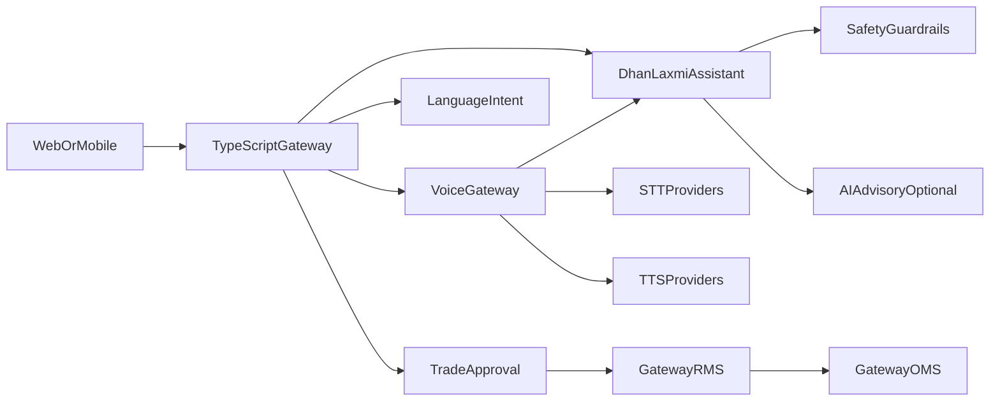

# DhanLaxmi — Indian Local Language AI Trading Assistant

Multilingual text/voice trading assistant for BusineXAi TradeOS360.

## Non-negotiables

- Never executes live trades without explicit user approval
- Never promises profit
- Always shows risk warnings
- Paper trading first
- Live requires confirmation (+ OTP/biometric when enabled), RMS, OMS, audit

## Architecture



## Quick start

```bash
docker compose -f docker-compose.dhanlaxmi.yml up -d --build
```

Gateway / service env (`backend/.env`):

```
DHANLAXMI_SERVICE_URL=http://localhost:8095
VOICE_GATEWAY_SERVICE_URL=http://localhost:8096
LANGUAGE_INTENT_SERVICE_URL=http://localhost:8097
TRADE_APPROVAL_SERVICE_URL=http://localhost:8098
SERVICE_HMAC_SECRET=dev-service-hmac-secret-change-me
DEFAULT_LLM_PROVIDER=claude
FALLBACK_LLM_PROVIDER=openrouter
BIFROST_ENABLED=true
BIFROST_BASE_URL=http://localhost:8080
OPENROUTER_API_KEY=                # optional secondary fallback
OPENROUTER_MODEL=openai/gpt-4o-mini
ALLOW_MOCK_LLM=true                # last-resort when Bifrost/OpenRouter unavailable
LLM_FORCE_ANTHROPIC=true
DEFAULT_STT_PROVIDER=mock
DEFAULT_TTS_PROVIDER=mock
```

Primary path is Bifrost → Claude. Without Bifrost/OpenRouter, DhanLaxmi falls back to `MockLLMProvider` (deterministic, paper-safe).

Tests:

```powershell
python -m pytest services/dhanlaxmi-assistant-service/tests -q
```

## Docs

- [docs/dhanlaxmi-assistant](docs/dhanlaxmi-assistant)
- [docs/voice-trading](docs/voice-trading)
- [docs/language-support](docs/language-support)
- [docs/approval-workflow](docs/approval-workflow)
- [docs/compliance](docs/compliance) (shared with advisory)
