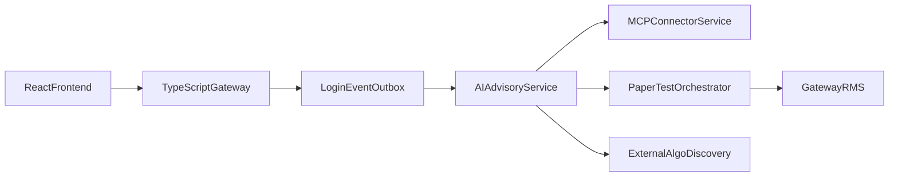

# AI Algo Advisory Engine

Login-triggered, compliance-aware strategy advisory for BusineXAi TradeOS.

## Architecture

## Flow

1. User logs in → gateway enqueues `user.login.success` (non-blocking).
2. Frontend shows **AI advisory is being prepared**.
3. `ai-advisory-service` collects redacted broker/portfolio/market context.
4. Market regime + recommendation engine produce 3–5 candidates (incl. no-trade when needed).
5. User converts → immutable strategy version → paper test → save → paper deploy.
6. Live requires paper qualification, license validation, risk disclosure, explicit confirmation, admin RMS, and `LIVE_TRADING_ENABLED`.

## APIs (gateway)

- `POST /api/advisory/generate`
- `GET /api/advisory/latest`
- `POST /api/advisory/{id}/recommendations/{rid}/convert-to-algo`
- `POST /api/strategy-options/{id}/paper-test`
- `POST /api/strategy-options/{id}/request-live-approval`
- `POST /api/external-algos/discover`

## Safety

- Never promises profit / guaranteed returns.
- Advisory never places orders.
- Live disabled by default.
- Paper test required.
- All AI decisions and approvals audited.
