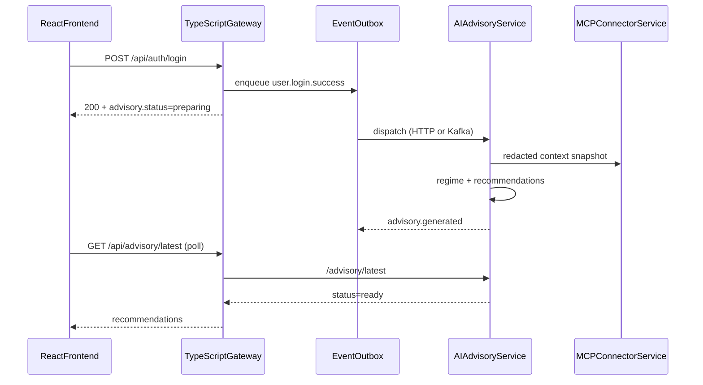
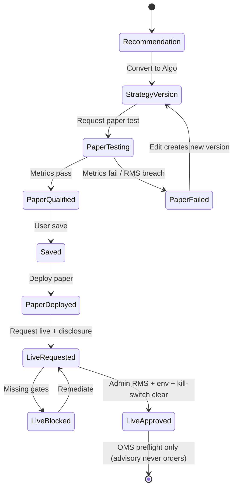

# Events, sequences, and deployment state machine

## Login → advisory sequence

## Strategy deployment state machine

## Kafka topics (canonical)

| Topic | Producer | Consumer |
|-------|----------|----------|
| `user.login.success` | Gateway outbox | AI advisory |
| `advisory.generation.requested` | AI advisory | AI advisory workers |
| `advisory.generated` | AI advisory | Gateway/metrics |
| `advisory.failed` | AI advisory | Gateway/metrics |
| `strategy.paper_test.requested` | Gateway / advisory | Paper orchestrator |
| `strategy.paper_test.completed` | Paper orchestrator | Advisory / UI |

Local: Redpanda via `docker-compose.advisory.yml`. Production: managed Kafka/Redpanda (not a Fargate sidecar).
