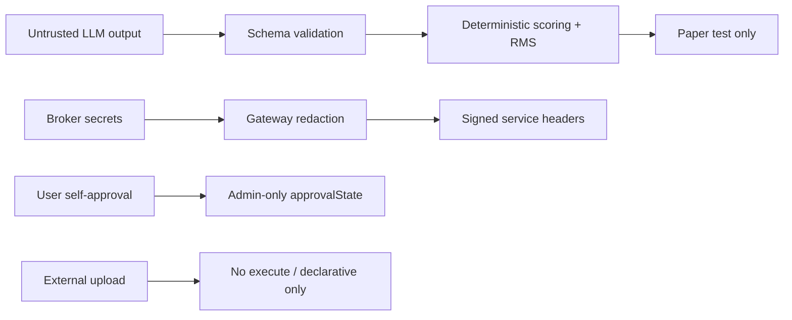

# Compliance & Risk Policy

## Non-negotiables

1. No guaranteed return / profit promises in any advisory text.
2. Live trading disabled by default (`LIVE_TRADING_ENABLED=false`).
3. Paper qualification required before live request.
4. Explicit user risk disclosure + second confirmation for live.
5. Admin-only RMS approval (`approvalState=APPROVED`); users cannot self-approve.
6. Kill switch blocks live paths including QuantConnect deploy.
7. External/third-party candidates sandboxed; no executable imports.
8. Broker secrets and PII redacted before LLM/prompts.
9. Tenant + user scoped data access.
10. Append-only advisory audit events for generation, conversion, paper tests, approvals.

## Threat model (summary)

- Prompt injection → schema validation + deterministic RMS after LLM.
- Credential leakage → service HMAC + redaction + no secrets in events.
- Self-approval bypass → admin gate on trading controls.
- Illegal scraping → discovery limited to APIs/licensed/internal/uploads.

## Compliance notes (DhanLaxmi)

- Assistant only — never autonomous trader.
- Risk warning on every trade-related response.
- Live requires user approval + RMS + OMS.
- Paper trading is default.
- Broker secrets/PII redacted before LLM.
- Audio history should be deletable by user (store path reserved).

