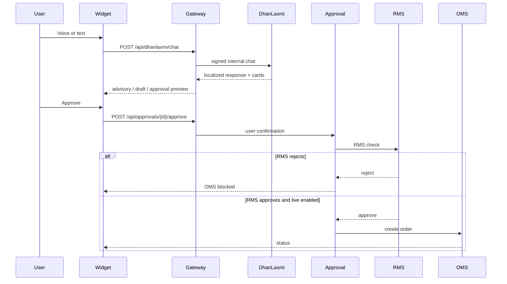

# DhanLaxmi Assistant

## Event sequence

## OpenAPI (gateway)

| Method | Path | Purpose |
|--------|------|---------|
| POST | `/api/dhanlaxmi/chat` | Text chat |
| POST | `/api/dhanlaxmi/intent` | Intent + parse |
| POST | `/api/dhanlaxmi/strategy-draft` | Strategy builder mode |
| POST | `/api/dhanlaxmi/advisory` | Advisory popup mode |
| POST | `/api/dhanlaxmi/paper-test` | Paper test draft |
| GET | `/api/dhanlaxmi/conversation/{id}` | History |
| POST | `/api/voice/command` | Voice → STT → chat → TTS |
| POST | `/api/approvals/trade` | Create approval |
| POST | `/api/approvals/{id}/approve` | Approve with gates |
| POST | `/api/approvals/{id}/reject` | Reject |

Kafka topic names (for production wiring): `dhanlaxmi.command.received`, `dhanlaxmi.intent.detected`, `dhanlaxmi.advisory.generated`, `dhanlaxmi.strategy.draft.created`, `dhanlaxmi.paper_test.requested`, `dhanlaxmi.trade_approval.requested|approved|rejected`, `dhanlaxmi.response.generated`, `compliance.audit.created`.
