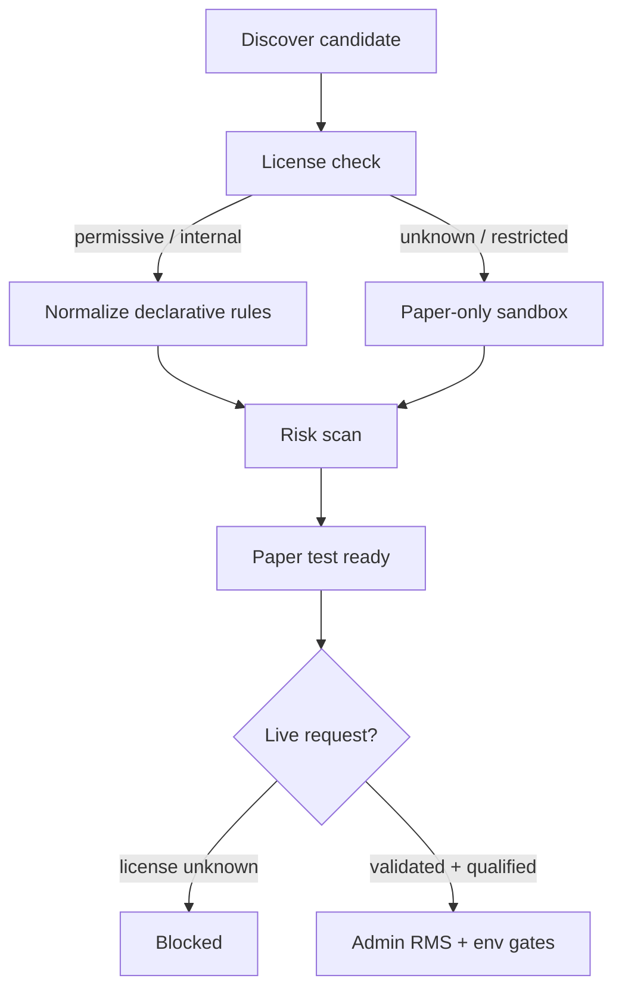

# Strategy Marketplace & External Discovery

## Allowed sources

- Internal BusineXAi library
- User-uploaded declarative JSON/CSV
- GitHub license metadata (no code scraping/execution)
- Partner marketplace APIs (placeholders)
- QuantConnect / TradingView **metadata only** when terms allow

## Candidate lifecycle

Discover → License check → Normalize → Risk scan → Paper test ready → User approval → Paper deploy → Live approval

Unknown license ⇒ `not_verified` / `license_unknown` ⇒ **cannot request live**.

## Licensing policy

- Do **not** scrape or execute imported source code.
- Accept declarative JSON/CSV strategy rules only after MIME/size/schema checks.
- Rank by suitability and data quality — never by unverified performance claims.
- Full import/rejection actions are audited.
